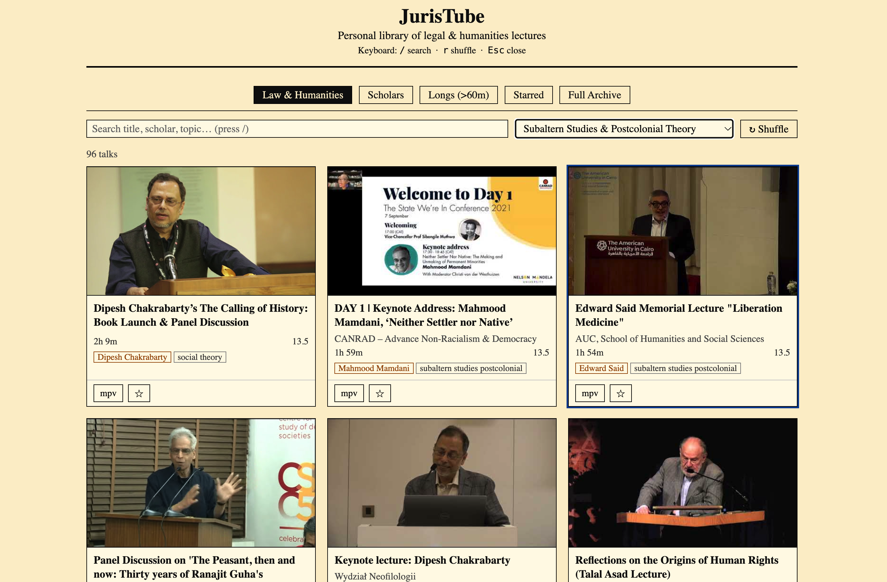

# JurisTube



## 1. Description
JurisTube is a self-hosted software application to search and watch academic videos.
The application helps researchers find lectures, symposia, and book discussions in legal theory and the humanities.
The system does not use commercial recommendation algorithms.

## 2. Features
- The software does not require an external web framework or database server.
- The software uses the Python standard library.
- The software does not require YouTube API keys.
- The software filters out short videos, promotional material, and non-academic content.
- The software calculates a quality score for each video.
- The software includes an interface that you can control with keyboard commands.
- You can play videos directly with the MPV media player or in the web browser.

## 3. Directory Structure
- `assets/`: Media files for documentation.
- `config/`: Configuration files in JSON format.
  - `scholars.json`: Names of scholars grouped by discipline.
  - `channels.json`: Institutional YouTube channels and priority tiers.
  - `feeds.json`: RSS feed addresses of academic blogs.
- `data/`: Storage directory for the SQLite database.
- `static/`: User interface stylesheet and JavaScript files.
- `templates/`: HTML template for the web interface.
- `db.py`: Database initialization script.
- `filter_engine.py`: Rules to filter and score videos.
- `ingest_scholars.py`: Script to search videos for listed scholars.
- `ingest_channels.py`: Script to collect videos from listed channels.
- `ingest_blogs.py`: Script to extract video links from blog RSS feeds.
- `import_hackertube.py`: Script to import archive data from HackerTube.
- `server.py`: Local web server script.

## 4. Technical Requirements
To use JurisTube, install the following software:
- Python (version 3.8 or later).
- `yt-dlp` (required to collect video metadata).
- `mpv` (optional, for local video playback).

### Installation of yt-dlp
On macOS, run:
```bash
brew install yt-dlp
```
On Linux, run:
```bash
pip install yt-dlp
```

### Installation of mpv (Optional)
On macOS, run:
```bash
brew install mpv
```

## 5. Setup Procedure

### Step 1: Initialize the Database
Run this command to create the database:
```bash
python3 db.py
```
This command creates the database file at `data/juristube.db`.

### Step 2: Start the Web Server
Run this command to start the local web server:
```bash
python3 server.py
```
Open your web browser and go to:
```
http://localhost:8085
```

## 6. Data Collection Procedures
JurisTube collects video data from four sources.

### Procedure A: Search Videos for Scholars
This script searches for academic talks by scholars listed in `config/scholars.json`.
- To search for all scholars, run:
  ```bash
  python3 ingest_scholars.py
  ```
- To search for the first 10 scholars, run:
  ```bash
  python3 ingest_scholars.py 10
  ```

### Procedure B: Collect Videos from Institutional Channels
This script collects recent videos from the channels listed in `config/channels.json`:
```bash
python3 ingest_channels.py
```

### Procedure C: Extract Videos from Academic Blogs
This script reads the RSS feeds in `config/feeds.json` and finds embedded YouTube links:
```bash
python3 ingest_blogs.py
```

### Procedure D: Import HackerTube Archive Data
To import an existing HackerTube dataset from `/tmp/hackertube-data/videos.jsonl`, run:
```bash
python3 import_hackertube.py
```

## 7. Keyboard Controls
Use these keys to operate the web interface:

| Key | Function |
| :--- | :--- |
| `j` or `Down Arrow` | Move to the next video. |
| `k` or `Up Arrow` | Move to the previous video. |
| `m` | Copy the `mpv` playback command to your clipboard. |
| `Enter` | Open video details and start the video player. |
| `/` | Move the cursor into the search field. |
| `Esc` | Close the video window or leave the search field. |

## 8. Configuration Files
- **`config/scholars.json`**: Add names of scholars and their academic disciplines.
- **`config/channels.json`**: Add YouTube channel URLs and assign an authority tier (1 to 3).
- **`config/feeds.json`**: Add RSS feed URLs for academic blogs.

## 9. License
This project is licensed under the MIT License.
